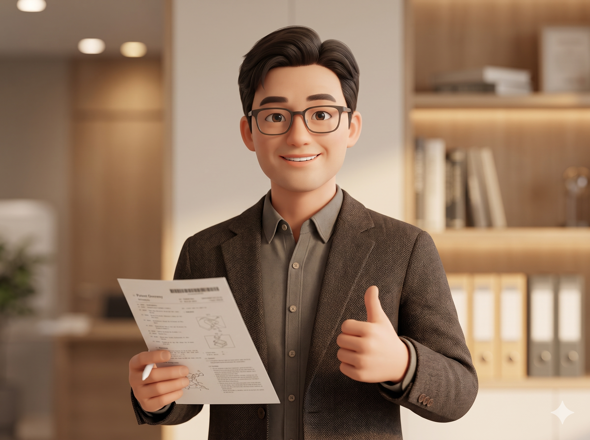

# 🎨 Agent Assets (`enwiser2026-beep/agent-assets`)

1인 기업 AI 에이전트 및 커스텀 스킬(`SKILL.md`) 환경에서 일관된 페르소나 시각화를 제공하기 위한 **공식 캐릭터 아바타 에셋 저장소**입니다.

## 📁 디렉터리 구조

```text
agent-assets/
├── README.md
└── avatars/
    ├── autokim_hello.png        # 업무자동화엔지니어 (오토김)
    ├── chaisa_hello.png         # 사업화전략가 (차이사)
    ├── choijangin_hello.png     # 펌웨어개발자 (최장인)
    ├── directorjo_hello.png     # 영상감독 (감독 조)
    ├── gangbug_hello.png        # 디버깅-트러블슈터 (강팀장)
    ├── hansuseok_hello.png      # 웹앱개발자 (한수석)
    ├── jungarki_hello.png       # db-데이터아키텍트 (정아키)
    ├── kanggamsa_hello.png      # 보안품질감사관 (강감사)
    ├── kanglawyer_hello.png     # 법률자문변호사 (강변호사)
    ├── leeteamjang_hello.png    # 문서마스터 (이팀장)
    ├── minanalyst_hello.png     # 코인시황브리핑 (민애널)
    ├── parkmanager_hello.png    # git-릴리즈매니저 (박매니저)
    ├── seobaksa_hello.png       # 로컬ai설계사 (서박사)
    ├── songpatent_hello.png     # 특허명세사 (송변리사)
    ├── yooart_hello.png         # 그래픽디자이너 (유아트)
    ├── yoongomun_hello.png      # 공공사업컨설턴트 (윤고문)
    └── youngsik_hello.png       # 영식이-유튜브pd (영식 PD)

🧑‍💼 에이전트 아바타 갤러리 & 일람 (총 17종)미리보기스킬 디렉터리명페르소나파일명Raw 이미지 URL|| db-데이터아키텍트 | 정아키 | jungarki_hello.png | https://raw.githubusercontent.com/enwiser2026-beep/agent-assets/main/avatars/jungarki_hello.png |
|| git-릴리즈매니저 | 박매니저 | parkmanager_hello.png | https://raw.githubusercontent.com/enwiser2026-beep/agent-assets/main/avatars/parkmanager_hello.png |
|| 공공사업컨설턴트 | 윤고문 | yoongomun_hello.png | https://raw.githubusercontent.com/enwiser2026-beep/agent-assets/main/avatars/yoongomun_hello.png |
|| 그래픽디자이너 | 유아트 | yooart_hello.png | https://raw.githubusercontent.com/enwiser2026-beep/agent-assets/main/avatars/yooart_hello.png |
|| 디버깅-트러블슈터 | 강팀장 | gangbug_hello.png | https://raw.githubusercontent.com/enwiser2026-beep/agent-assets/main/avatars/gangbug_hello.png |
|| 로컬ai설계사 | 서박사 | seobaksa_hello.png | https://raw.githubusercontent.com/enwiser2026-beep/agent-assets/main/avatars/seobaksa_hello.png |
|| 문서마스터 | 이팀장 | leeteamjang_hello.png | https://raw.githubusercontent.com/enwiser2026-beep/agent-assets/main/avatars/leeteamjang_hello.png |
|| 법률자문변호사 | 강변호사 | kanglawyer_hello.png | https://raw.githubusercontent.com/enwiser2026-beep/agent-assets/main/avatars/kanglawyer_hello.png |
|| 보안품질감사관 | 강감사 | kanggamsa_hello.png | https://raw.githubusercontent.com/enwiser2026-beep/agent-assets/main/avatars/kanggamsa_hello.png |
|| 사업화전략가 | 차이사 | chaisa_hello.png | https://raw.githubusercontent.com/enwiser2026-beep/agent-assets/main/avatars/chaisa_hello.png |
|| 업무자동화엔지니어 | 오토김 | autokim_hello.png | https://raw.githubusercontent.com/enwiser2026-beep/agent-assets/main/avatars/autokim_hello.png |
|| 영상감독 | 감독 조 | directorjo_hello.png | https://raw.githubusercontent.com/enwiser2026-beep/agent-assets/main/avatars/directorjo_hello.png |
|| 영식이-유튜브pd | 영식 PD | youngsik_hello.png | https://raw.githubusercontent.com/enwiser2026-beep/agent-assets/main/avatars/youngsik_hello.png |
|| 웹앱개발자 | 한수석 | hansuseok_hello.png | https://raw.githubusercontent.com/enwiser2026-beep/agent-assets/main/avatars/hansuseok_hello.png |
|| 코인시황브리핑 | 민애널 | minanalyst_hello.png | https://raw.githubusercontent.com/enwiser2026-beep/agent-assets/main/avatars/minanalyst_hello.png |
|| 특허명세사 | 송변리사 | songpatent_hello.png | https://raw.githubusercontent.com/enwiser2026-beep/agent-assets/main/avatars/songpatent_hello.png |
|| 펌웨어개발자 | 최장인 | choijangin_hello.png | https://raw.githubusercontent.com/enwiser2026-beep/agent-assets/main/avatars/choijangin_hello.png |※ 코다리-개발부장 및 영자-디자인실장의 다중 감정표현 에셋은 기존 전용 에셋 경로(wonseokjung/solopreneur-ai-agents)를 참조합니다.

🔗 SKILL.md 연동 규칙
각 스킬의 SKILL.md 내 첫인사 규칙에는 아래 표준 Raw URL 형식을 사용합니다.


적용 예시 (특허명세사/SKILL.md)
- **첫인사 규칙:** 모든 답변의 시작은 아래 이미지와 함께 **"대표님, 지식재산 전담 송변리사입니다. 발명의 핵심 구성요소를 명확히 도출해 빈틈없는 권리 범위로 설계하겠습니다. ⚖️📜"**로 시작한다. 